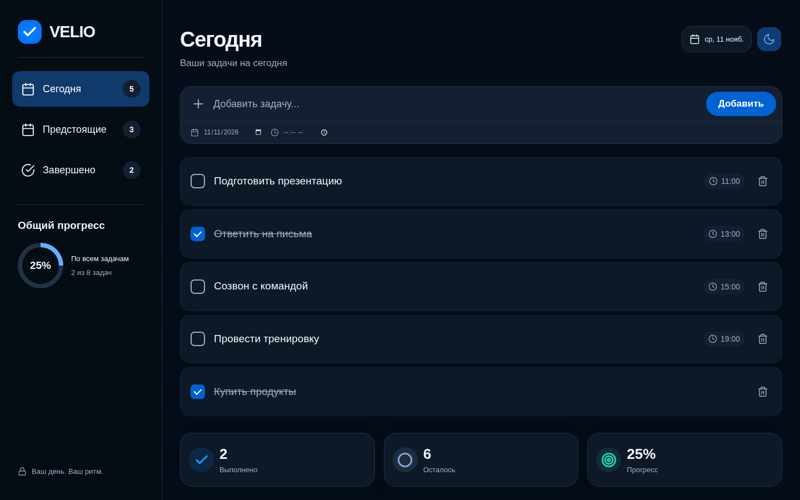
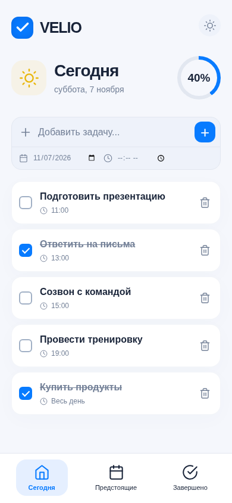

# VELIO

**Менеджер задач с адаптивным интерфейсом, календарём и сохранением данных в браузере.**

[Открыть приложение](https://y26216048-design.github.io/focus-todo-list/) · [Посмотреть проверки](https://github.com/y26216048-design/focus-todo-list/actions/workflows/check.yml)

[](https://github.com/y26216048-design/focus-todo-list/actions/workflows/check.yml)

VELIO помогает спланировать день, распределить задачи по датам и отслеживать выполнение. Приложение работает без регистрации и серверной части. Компьютерная версия занимает окно браузера целиком; на телефоне используется нижняя навигация.



<details>
<summary>Мобильная версия — светлая тема</summary>



</details>

## Что можно делать

- **Сегодня:** добавлять задачи, указывать время и отмечать выполнение. Просроченные невыполненные задачи остаются видимыми.
- **Предстоящие:** планировать задачи на будущие даты и просматривать их с группировкой по дням.
- **Завершено:** просматривать выполненные задачи, возвращать их в активные или удалять.
- **Календарь на компьютере:** выбирать дату, просматривать её задачи и добавлять новые. Окно закрывается кнопкой или клавишей `Esc`.
- **Прогресс:** видеть реальные счётчики и долю выполненных задач среди всех задач. Карточки «Выполнено» и «Осталось» открывают соответствующие разделы.
- **Удаление с отменой:** восстановить последнюю удалённую задачу в течение пяти секунд.
- **Оформление:** переключать светлую и тёмную темы. Солнце обозначает светлую тему, луна — тёмную; выбор сохраняется.

Задачи восстанавливаются после обновления страницы и синхронизируются между вкладками одного браузера. Переходы и появление элементов анимированы, а прогресс обновляется сразу; настройка системы `prefers-reduced-motion` отключает анимации.

При первом открытии приложение создаёт восемь редактируемых примеров. Их можно удалить — при следующем запуске они не появятся снова.

## Технологии и решения

| Технология                  | Использование                                                    |
| --------------------------- | ---------------------------------------------------------------- |
| HTML5                       | Формы, навигация и нативный диалог календаря                     |
| CSS                         | Адаптивная сетка, переменные тем, состояния элементов и анимации |
| JavaScript                  | Состояние задач, обработчики действий, даты и обновление DOM     |
| localStorage                | Сохранение задач и выбранной темы                                |
| Feather Icons               | Иконки, включённые в проект локально                             |
| Vite / Prettier             | Сервер разработки и единое форматирование кода                   |
| Playwright / GitHub Actions | Браузерные сценарии и автоматические проверки                    |
| GitHub Pages                | Публикация статического сайта по HTTPS                           |

Для небольшого приложения используется обычный JavaScript без UI-фреймворка. Рабочий интерфейс не требует API, учётных данных или загрузки библиотек с CDN. Vite нужен для разработки; сборка состоит из статических файлов.

## Быстрый запуск

Потребуются Git и **Node.js 24** — эта версия используется в CI. Python нужен только для браузерных тестов или запуска дополнительного статического сервера.

```sh
git clone https://github.com/y26216048-design/focus-todo-list.git
cd focus-todo-list
npm ci
npm run dev -- --port 4173 --strictPort
```

Откройте **http://localhost:4173/**. Настраивать переменные окружения и подключать базу данных не требуется.

### Сборка

```sh
npm run build
```

Команда обновляет версии CSS и JavaScript в корневом `index.html`, затем копирует сайт в `dist/`. Версии вычисляются из содержимого файлов и помогают избежать загрузки старых ресурсов из кэша.

Для отдельной проверки сборки можно запустить:

```sh
python3 -m http.server 4174 --bind 127.0.0.1 --directory dist
```

Собранное приложение будет доступно по **http://localhost:4174/**.

## Проверка проекта

### Форматирование

```sh
npm run format:check
```

Исправить форматирование исходников можно командой `npm run format`.

### Браузерные тесты

В CI используется Python 3.12. Следующие команды рассчитаны на Linux/macOS и выполняются в отдельном терминале из корня проекта, пока сервер на порту `4173` работает:

```sh
python3 -m venv .venv
source .venv/bin/activate
python3 -m pip install -r requirements-dev.txt
python3 -m playwright install chromium
npm test
```

Если в Linux не хватает системных библиотек Chromium, Playwright позволяет установить их командой `python3 -m playwright install --with-deps chromium`.

По умолчанию тесты открывают `http://127.0.0.1:4173/`. Для проверки сборки на другом порту:

```sh
BASE_URL=http://127.0.0.1:4174/ npm test
```

Тесты используют `/usr/bin/chromium`, если он есть; иначе запускают Chromium из Playwright. Другой путь можно задать через `CHROMIUM_PATH`.

**Что проверяется:**

- Добавление, выполнение, возврат в активные, удаление и отмена удаления.
- Сохранение после перезагрузки, все три раздела, выбор дат и календарь.
- Пустые состояния и вывод пользовательского текста без интерпретации HTML.
- Переключение тем, анимация прогресса и режим reduced motion.
- Мобильные размеры 320×740 и 390×844, планшет 768×1024, компьютерные окна вплоть до 1920×1080.
- Заполнение окна, центровка счётчиков, отсутствие горизонтальной прокрутки и доступность последней задачи над нижней панелью.

Скриншоты сохраняются в `test-results/`. В GitHub Actions при ошибке они доступны в артефакте `browser-screenshots`.

### Автоматические проверки

Workflow [Check VELIO](.github/workflows/check.yml) запускается при каждом push в `main` и при открытии или обновлении pull request. Он устанавливает зависимости, проверяет форматирование, собирает сайт и запускает оба набора браузерных тестов на содержимом `dist/`.

## Структура проекта

```text
.
├── index.html                  # Разметка интерфейса и диалог календаря
├── styles.css                  # Адаптивные стили, темы и анимации
├── app.js                      # Логика приложения
├── scripts/
│   ├── build.cjs               # Копирование статического сайта в dist/
│   └── version-assets.cjs      # Версии ресурсов по хэшу содержимого
├── tests/
│   ├── browser.py              # Пользовательские сценарии
│   └── layout.py               # Сетка, счётчики и анимации
├── docs/                       # Скриншоты интерфейса
├── vendor/                     # Локальные иконки и их лицензия
├── .github/workflows/check.yml # CI
├── package.json                # Команды и зависимости Node.js
└── requirements-dev.txt        # Зависимости браузерных тестов
```

### Состояние и данные

В `app.js` функции чтения и записи хранилища, построения задач, отрисовки разделов и анимации прогресса отделены друг от друга. Состояние хранится в массиве задач, а действия пользователя обновляют данные и интерфейс.

У задачи есть `id`, `text`, `date`, `time` и `done`. Даты хранятся в формате `YYYY-MM-DD` и обрабатываются в локальном часовом поясе. Список сохраняется под ключом `velio-tasks-v1`, тема — `velio-theme`. Старые задачи из `focus-todo-tasks-v1` импортируются при первом запуске новой версии.

Пользовательский текст вставляется через `textContent`. При недоступном localStorage приложение показывает предупреждение о невозможности сохранения.

## Публикация обновлений

Сайт опубликован из **существующего репозитория** через GitHub Pages: ветка `main`, папка `/ (root)`. Поэтому перед коммитом изменений CSS или JavaScript нужно запустить `npm run build` и включить обновлённый `index.html` в коммит. После push в `main` Pages автоматически публикует обновление.

Все пути к ресурсам относительные: приложение работает в подпапке `/focus-todo-list/`. GitHub Pages может кэшировать страницу до десяти минут; версии ресурсов помогают получать актуальные стили и скрипты после загрузки нового HTML.

## Ограничения

- Данные привязаны к браузеру, устройству и домену. Между телефоном и компьютером синхронизации нет.
- Очистка данных браузера удаляет задачи; облачного резервного копирования нет.
- В разделе завершённых показана запланированная дата задачи, а не дата её выполнения.
- Уведомления, регистрация и серверная часть не реализованы.
- Мобильные сценарии проверяются в эмуляции Chromium, а не на физических Android- и iOS-устройствах.

## Сторонние материалы

Иконки — [Feather Icons](https://feathericons.com/), лицензия MIT. Копия лицензии находится в [vendor/feather-LICENSE](vendor/feather-LICENSE).
